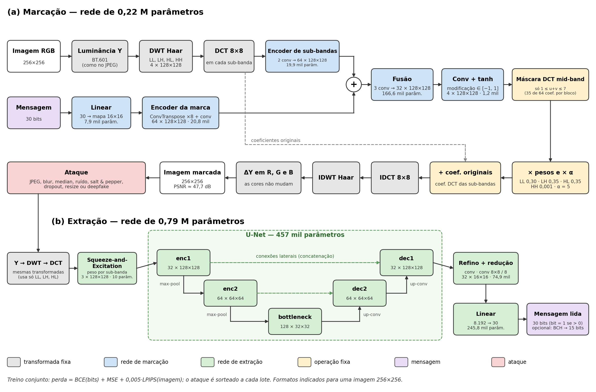
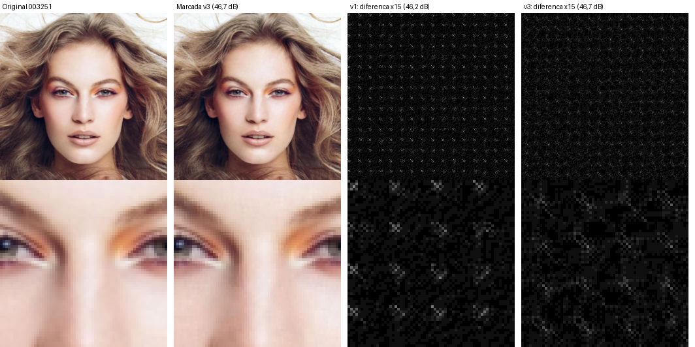

# Marca d'água robusta DWT–DCT + CNN para rostos 256×256 (versão 3)

Marca d'água invisível de **30 bits** embutida no canal de luminância (Y) de imagens **256×256**, no domínio DWT → DCT, por uma CNN treinada junto com um extrator robusto a ataques. Pensada para fotos de rosto (CelebA-HQ): a marca sobrevive a compressão, filtros, ruído, redimensionamento e às manipulações por deepfake testadas, e serve para **rastrear a origem** da imagem.

Opcionalmente, um código corretor de erros **BCH** transforma os 30 bits em 15 bits de mensagem + 15 de paridade e corrige até 3 bits errados.

> Este README cobre só a **versão atual**. A história do projeto (versões 1 e 2, experimentos e por que cada escolha foi feita) está em [`my_README.md`](my_README.md) e em `../Robust-Hybrid-Watermarking-cnn-256/my_README.md`.

## Como funciona

**Marcar** (`watermark_embedding.py`):

1. A imagem RGB vira luminância **Y** (BT.601, a mesma do JPEG).
2. **DWT Haar** de 1 nível → 4 sub-bandas de 128×128 (LL, LH, HL, HH).
3. **DCT em blocos 8×8** em cada sub-banda.
4. Os 30 bits passam por uma camada `Linear` → mapa 16×16 → `ConvTranspose` → 128×128.
5. Uma CNN combina a marca com as sub-bandas e gera a modificação (`tanh`), que é:
   - **multiplicada por uma máscara DCT mid-band** — só os coeficientes com 1 ≤ u+v ≤ 7 de cada bloco 8×8 são alterados (sem o DC e sem as frequências altas), o que evita o padrão em grade;
   - ponderada pelos pesos das sub-bandas (LL 0,30 / LH 0,35 / HL 0,35 / HH 0,001);
   - multiplicada pela força **alpha** (5 no modelo atual).
6. IDCT → IDWT; a diferença em Y é somada igualmente a R, G e B (as cores não mudam).

**Extrair** (`watermark_extraction.py`): a imagem passa pelas mesmas transformadas; LL, LH e HL entram num bloco Squeeze-and-Excitation e num U-Net, e uma camada `Linear` devolve os 30 bits.

**Treinar** (`train.py`): a cada batch, um ataque é sorteado e aplicado entre a marcação e a extração, e a rede aprende a ler a marca depois dele. Ataques do treino (`--attack_set v2`): nenhum, JPEG simulado (DiffJPEG), JPEG real (OpenCV, com o gradiente do DiffJPEG), blur, median 3 ou 5, ruído gaussiano, salt & pepper, dropout até 0,3, resize, resize + JPEG e deformação geométrica (rotação ±2°, deslocamento ±3 px, escala ±3%). A loss soma o erro dos bits (BCE) com o da imagem (MSE + 0,005 × LPIPS). O alpha começa em 100 e cai até 5 conforme a rede aprende.

### Arquitetura e dimensões



Figura gerada por `gerar_figura_arquitetura.py` (PNG e PDF em `my_tests/arquitetura/`). Formatos para uma imagem 256×256, no formato canais × altura×largura.

**Marcação (216.292 parâmetros).** A DWT reduz 256×256 para 128×128 e, depois disso, **nenhuma camada muda o tamanho espacial**: todas as convoluções são 3×3 com padding 1, sem stride e sem pooling, e só o número de canais muda. Assim, cada posição da modificação corresponde a um coeficiente DCT de cada sub-banda, o que permite aplicar a máscara mid-band coeficiente a coeficiente. A única ampliação é a da mensagem, que precisa ter o tamanho das sub-bandas para ser somada a elas.

| Etapa | Operação | Saída | Parâmetros |
|---|---|---|---|
| Transformadas | Y → DWT Haar → DCT 8×8 | 4 × 128×128 | — |
| Encoder de sub-bandas | 2 conv 3×3 | 64 × 128×128 | 19.872 |
| Mensagem | `Linear` 30 → 256 → mapa | 1 × 16×16 | 7.936 |
| Encoder da marca | `ConvTranspose` kernel 8, stride 8 (16 → 128) + conv 3×3 | 64 × 128×128 | 20.768 |
| Soma | sub-bandas + marca | 64 × 128×128 | — |
| Fusão | 3 conv 3×3 (64 → 128 → 64 → 32) | 32 × 128×128 | 166.560 |
| Saída | conv 3×3 + `tanh` | 4 × 128×128 | 1.156 |
| Máscara, pesos, alpha | só 1 ≤ u+v ≤ 7; × pesos das sub-bandas; × 5 | 4 × 128×128 | — |
| Reconstrução | + coeficientes originais → IDCT → IDWT → ΔY em R, G, B | 3 × 256×256 | — |

**Extração (788.456 parâmetros).** Ao contrário da marcação, a extração reduz e amplia a resolução: o U-Net desce até 32×32 para juntar contexto (o que ajuda contra blur, resize e deslocamentos), as conexões laterais devolvem os detalhes finos, e a conv 8×8 com stride 8 volta para a grade de blocos DCT em que a marca foi inserida (um vetor por bloco). A `Linear` final liga todos os blocos a todos os bits, o que dá redundância contra dropout e salt & pepper.

| Etapa | Operação | Saída | Parâmetros |
|---|---|---|---|
| Transformadas | Y → DWT → DCT, só LL, LH e HL | 3 × 128×128 | — |
| Squeeze-and-Excitation | um peso por sub-banda (o tamanho não muda) | 3 × 128×128 | 10 |
| enc1 | 2 conv 3×3 | 32 × 128×128 | 10.272 |
| enc2 | MaxPool 2×2 + 2 conv 3×3 | 64 × 64×64 | 55.680 |
| bottleneck | MaxPool 2×2 + 2 conv 3×3 | 128 × 32×32 | 221.952 |
| dec2 | `ConvTranspose` 2×2 / 2 + concat enc2 + 2 conv 3×3 | 64 × 64×64 | 32.832 + 110.976 |
| dec1 | `ConvTranspose` 2×2 / 2 + concat enc1 + 2 conv 3×3 | 32 × 128×128 | 8.224 + 27.840 |
| Refino | conv 3×3 | 32 × 128×128 | 9.312 |
| Redução | conv 8×8, stride 8 (um vetor por bloco DCT) | 32 × 16×16 | 65.568 |
| Bits | achata (8.192) → `Linear` → bit = 1 se > 0 | 30 | 245.790 |

## Modelo atual

| Item | Valor |
|---|---|
| Checkpoint | `output_grade/v3_finetune_cosine/checkpoints/watermark_Y_DCT_DWT_12102026_08:55:13_final.pth` |
| Resolução / marca | 256×256 / 30 bits |
| Alpha | **5** (salvo no checkpoint) |
| Treino | etapa 1: do zero, 50 épocas, LR 5e-5 (≈1h50); etapa 2: +15 épocas com LR em cosseno 2e-5 → 1e-6 (≈32 min) — numa RTX 3090 |
| Dataset | CelebA-HQ 256×256: 28.000 imagens de treino e 2.000 de validação |

> Os checkpoints deste projeto só carregam com o `watermark_embedding.py` daqui (a máscara DCT é o buffer `dct_band_mask`).

## Instalação

### 1. Ambiente

```bash
conda env create -f environment.yml
conda activate watermark-v3
```

O `environment.yml` traz as versões usadas (Python 3.12, PyTorch 2.11 com CUDA 12.8, `pytorch_wavelets`, `torch-dct`, `kornia`, `lpips`, `DISTS-pytorch`, `torchmetrics`, `bchlib`, …). Para outra versão de CUDA, troque o índice do PyTorch no arquivo. Na primeira execução, o LPIPS e o DISTS baixam os próprios pesos.

### 2. Dataset

CelebA-HQ em 256×256, separado por gênero na validação (o `--limit` dos scripts usa metade de cada gênero):

```text
Dataset/
└── celeba_hq/
    ├── train/
    │   ├── female/   (imagens .jpg)
    │   └── male/
    └── val/
        ├── female/
        └── male/
```

Uma fonte é o Kaggle (`kaggle datasets download -d lamsimon/celebahq`), que já vem em `train/` e `val/` com `female/` e `male/`. As imagens são redimensionadas para 256×256 pelos scripts. Neste diretório, `Dataset/` é um link para o dataset do projeto original.

### 3. Modelo treinado

O checkpoint do modelo atual fica em `output_grade/v3_finetune_cosine/checkpoints/`. Para treinar de novo, veja [Treino](#treino).

## Uso

Todos os comandos rodam de dentro desta pasta, com o ambiente ativado. Para encurtar:

```bash
CK="output_grade/v3_finetune_cosine/checkpoints/watermark_Y_DCT_DWT_12102026_08:55:13_final.pth"
```

### Avaliar a robustez (métricas principais)

```bash
python evaluate.py \
    --models_path "$CK" \
    --image_resolution 256 \
    --celeba_val_dir Dataset/celeba_hq/val \
    --output results/v3_2000 \
    --deepfake false
```

- Marca as imagens de validação com uma mensagem fixa de 30 bits (seed 42), aplica **16 ataques** e extrai a marca de cada imagem atacada.
- Saídas em `--output`: `media_per_attack.csv` (média por ataque) e `results_per_image.csv` (por imagem), com BER, Bit Accuracy, marca exata (`Exact Match`), PSNR, SSIM, LPIPS e DISTS. A tabela também é impressa no terminal.
- **`--image_resolution 256` é obrigatório** (o padrão do script é 128).
- **`--deepfake false` também**, para só os ataques comuns: o padrão do script é `true`, que roda os 7 deepfakes (veja abaixo).
- `--limit N`: usa só N imagens (metade de cada gênero), para testes rápidos. Sem ele, usa as 2.000.
- `--alpha`: marca com outra força (padrão: o alpha do checkpoint, 5).
- PSNR, SSIM, LPIPS e DISTS comparam a imagem **original** com a **marcada e atacada**: na linha `none` medem a invisibilidade da marca; nas outras, quanto o próprio ataque degradou a imagem.
- Use um `--output` diferente a cada execução: a pasta é sobrescrita.

Ataques avaliados:

| Ataque | Parâmetros |
|---|---|
| `none` | – |
| `jpeg_test`, `jpeg_test_forte50`, `jpeg_test_forte30` | JPEG real (PIL) com Q = 75, 50, 30 |
| `blur` | gaussiano, σ = 2 |
| `median_blur`, `median_blur_forte` | mediana 3×3 e 5×5 |
| `noise`, `noise_forte` | ruído gaussiano, σ = 0,02 e 0,05 |
| `salt_pepper`, `salt_pepper_forte` | 1% e 5% dos pixels viram preto ou branco |
| `dropout`, `dropout_forte10`, `dropout_forte20` | 5%, 10% e 20% dos pixels zerados |
| `resize`, `resize_forte` | reduz para 0,5 e 0,3 do tamanho e volta |

### Avaliar com deepfakes (opcional)

```bash
python evaluate.py --models_path "$CK" --image_resolution 256 \
    --celeba_val_dir Dataset/celeba_hq/val --output results/v3_deepfakes_100 \
    --deepfake true --limit 100
```

Aplica também 7 deepfakes nas imagens marcadas: DiffAE (atributo `Young`), BlendFace, SimSwap, InSwapper, StarGAN (`Male`), HiSD (óculos) e LivePortrait. Cada imagem recebe uma identidade de origem fixa do mesmo gênero (`pares_origem.csv`). Exige os modelos e ambientes conda de cada deepfake em `../../models_deepfake/` (caminhos em `deepfake_attack.py`). O DiffAE leva ≈11 s por imagem; com 100 imagens, a avaliação completa leva ≈30 min.

### Avaliar com o código corretor de erros (BCH)

```bash
python avaliar_bch.py --models_path "$CK" --output results/bch_v3_2000.csv
```

- Cada imagem recebe uma mensagem de 15 bits diferente, codificada em 30 bits com `bch_codec.py`, e a extração é decodificada (até 3 bits errados são corrigidos).
- Por ataque: acurácia de bits, marca exata sem BCH, **mensagem recuperada com BCH**, falha avisada (mais de 3 erros, detectada) e erro silencioso (o BCH devolve uma mensagem errada sem avisar).
- Aceita `--alpha` e `--limit` como o `evaluate.py`.

Para usar o BCH no seu código:

```python
from bch_codec import BCH3015, int_to_bits, bits_to_int
codec = BCH3015()
bits30 = codec.encode(int_to_bits(12345))   # 30 bits para esconder na imagem
msg15, n_corrigidos = codec.decode(bits_lidos)
id_lido = bits_to_int(msg15) if msg15 is not None else None   # None = marca ilegível
```

### Marcar uma imagem e ver a diferença

```bash
python collect_image_by_diff.py --models_path "$CK" --dataset_dir Dataset/celeba_hq/val \
    --output_dir my_tests/exemplo --reference_name 003251 --reference_file 003251.jpg \
    --image_resolution 256

python watermark_diff.py --original my_tests/exemplo/003251_original.png \
    --watermarked my_tests/exemplo/003251_marcada.png --output_dir my_tests/exemplo/resultado_diff
```

O primeiro salva a imagem original e a marcada; o segundo gera a diferença amplificada 15× (`diferenca.png`), um grid comparativo e imprime o PSNR. Troque `--reference_file` para usar outra imagem do dataset.

### Ver a imagem de referência sob cada ataque

```bash
python gerar_imagens_ataques.py                              # os 16 ataques
python gerar_imagens_ataques.py --attack jpeg_test_forte30   # só um ataque
python gerar_imagens_ataques.py --list                       # nomes dos ataques
```

Marca a imagem de referência (003251) com o modelo atual, aplica os mesmos ataques do `evaluate.py` e salva em `my_tests/ataques_003251/<ataque>/`:

- `original.png`, `marcada.png` e `marcada_atacada.png`;
- `grid.png`: original | marcada | marcada + ataque, com o PSNR de cada uma e quantos bits a marca extraída da imagem atacada acertou.

Também gera `resumo.csv` (ou `resumo_<ataque>.csv` com `--attack`), com PSNR, bits errados e a marca extraída por ataque. Cada ataque usa uma seed fixa, então rodá-lo sozinho gera a mesma imagem que rodar todos. Opções: `--image_path` (outra imagem), `--models_path`, `--alpha`, `--output_dir`.

### Treino

Etapa 1 — do zero (≈1h50 numa RTX 3090):

```bash
python train.py \
    --dataset_path Dataset/celeba_hq/train \
    --image_resolution 256 \
    --watermark_size 30 \
    --output output_grade/op3_v2_geometrico_alpha5_50ep \
    --batch_size 32 \
    --num_epochs 50 \
    --lr 5e-5 \
    --seed 42 \
    --min_alpha 5 \
    --alpha_patience 1000 \
    --attack_set v2 \
    --lpips_weight 0.005 \
    --subband_weights 0.30,0.35,0.35,0.001
```

Etapa 2 — fine-tuning com LR em cosseno (≈32 min):

```bash
python train.py \
    --dataset_path Dataset/celeba_hq/train \
    --image_resolution 256 \
    --watermark_size 30 \
    --output output_grade/v3_finetune_cosine \
    --resume "output_grade/op3_v2_geometrico_alpha5_50ep/checkpoints/<checkpoint da etapa 1>_final.pth" \
    --min_alpha 5 \
    --attack_set v2 \
    --lpips_weight 0.005 \
    --batch_size 32 \
    --num_epochs 15 \
    --lr 2e-5 \
    --lr_schedule cosine \
    --lr_min 1e-6 \
    --seed 42
```

- `--watermark_size` é o número de bits da marca.
- Cada treino salva em `<output>/checkpoints/` um `*_model.pth` a cada 5.000 passos e o `*_final.pth` no fim (use o final), e os logs do TensorBoard em `<output>/logs/` (`tensorboard --logdir <output>/logs`).
- `--resume` carrega os pesos de um checkpoint e já começa com a loss da imagem no peso máximo; o alpha inicial vem do checkpoint.
- Use um `--output` diferente para cada treino.

## Resultados do modelo atual

`evaluate.py` nas 2.000 imagens de validação, alpha 5, seed 42.

### Qualidade (original × marcada)

| PSNR | SSIM | LPIPS | DISTS |
|---|---|---|---|
| 47,69 dB | 0,992 | 0,0030 | 0,029 |

### Robustez

| Ataque | Parâmetro | Marca exata (30 bits) | Bit Accuracy | Mensagem certa com BCH (15 bits) | Bit Accuracy com BCH (15 bits) |
|---|---|---|---|---|---|
| Nenhum | – | 100% | 100% | 100% | 100% |
| JPEG | Q=75 | 99,2% | 99,97% | 100% | 100% |
| JPEG | Q=50 | 85,0% | 99,41% | 99,95% | 99,99% |
| JPEG | Q=30 | 25,9% | 95,45% | 94,3% | 99,08% |
| Blur | σ=2 | 97,4% | 99,89% | 100% | 100% |
| Median | 3×3 | 97,9% | 99,92% | 100% | 100% |
| Median | 5×5 | 91,7% | 99,65% | 99,95% | 100% |
| Ruído | σ=0,02 | 99,95% | 99,998% | 100% | 100% |
| Ruído | σ=0,05 | 95,7% | 99,85% | 99,95% | 99,99% |
| Salt & pepper | 1% | 99,8% | 99,99% | 100% | 100% |
| Salt & pepper | 5% | 77,9% | 99,11% | 99,95% | 100% |
| Dropout | 5% | 96,3% | 99,87% | 100% | 100% |
| Dropout | 10% | 81,3% | 99,22% | 99,9% | 99,99% |
| Dropout | 20% | 44,2% | 96,54% | 95,1% | 99,19% |
| Resize | 0,5 | 92,4% | 99,67% | 99,85% | 99,98% |
| Resize | 0,3 | 70,8% | 98,47% | 99,1% | 99,86% |

- "Bit Accuracy com BCH" é a fração dos 15 bits de mensagem certos depois da correção; quando o BCH não consegue corrigir, conta os 15 bits como foram lidos.
- "Marca exata" exige os 30 bits certos. Com BCH, a mensagem de 15 bits é recuperada em **≥ 99% das imagens em 13 dos 15 ataques**; ficam abaixo o JPEG Q30 (94,3%) e o dropout de 20% (95,1%). Mais de 3 bits errados geram, na maioria das vezes, um aviso de marca ilegível; respostas erradas sem aviso ficam em ≤ 0,9%.
- O dropout de 50% foi retirado da avaliação: ele zera metade dos pixels e degrada a imagem a ponto de ela perder o uso (PSNR ≈9 dB), então não representa um ataque realista.
- CSVs: `results/op3_2000_50ep_finetune/` (`evaluate.py`) e `results/bch_v3_2000_alpha5.csv` (BCH).

### Aparência da marca



*Imagem 003251: original, marcada (46,7 dB nesta imagem) e a diferença amplificada 15× da versão anterior (v1, com o padrão em grade) e da atual (embaixo, recorte ampliado). Na versão atual a marca é uma textura fina e irregular, sem a grade de pontos.*

### Limitações

- **Dropout de 20%** e **JPEG Q30** ainda perdem bits (44% e 26% de marca exata); com BCH, ≈95% e ≈94%.
- **Capacidade com BCH:** 15 bits = 32.768 mensagens diferentes. Para 30 bits de mensagem com a mesma proteção, a rede teria que esconder ≈48 bits (novo treino).
- **Deepfakes ainda não avaliados** nesta versão (comando acima).
- **Textura residual:** sem a grade, mas a diferença amplificada mostra uma textura fina, com leve orientação diagonal.

## Arquivos principais

| Arquivo | Função |
|---|---|
| `watermark_embedding.py` | rede de marcação (com a máscara DCT mid-band) e `watermark_embedding_tensor` |
| `watermark_extraction.py` | rede de extração |
| `attacks.py` | ataques do treino (`ATTACK_SETS`) e da avaliação |
| `train.py` | treino (`--attack_set`, `--resume`, `--lr_schedule`, `--subband_weights`, `--lpips_weight`, …) |
| `evaluate.py` | avaliação com 16 ataques e, opcionalmente, 7 deepfakes |
| `deepfake_attack.py` | chamada dos modelos de deepfake externos |
| `bch_codec.py`, `avaliar_bch.py` | código corretor de erros BCH(30, 15) e sua avaliação |
| `collect_image_by_diff.py`, `watermark_diff.py` | marcar uma imagem e visualizar a diferença |
| `gerar_imagens_ataques.py` | imagem de referência marcada sob cada ataque (imagens e grid) |
| `gerar_figura_arquitetura.py` | figura da arquitetura (`my_tests/arquitetura/`) |
| `output_subbandas/avaliar_ablacao.py` | comparar vários checkpoints de uma pasta |
| `utils.py` | DWT/DCT em blocos e funções auxiliares |
| `environment.yml` | ambiente conda |
| `my_README.md` | histórico detalhado do desenvolvimento |
