# Versão 3 — marca DCT mid-band + ataque geométrico (30 bits, 256×256)

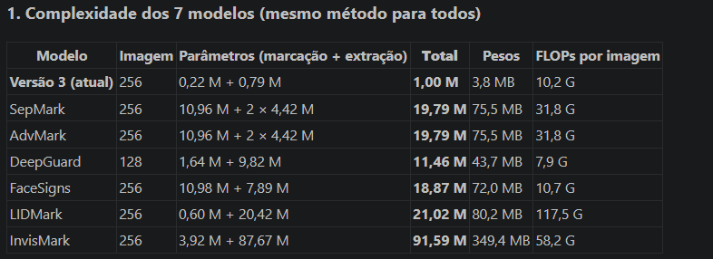

Evolução do modelo `Robust-Hybrid-Watermarking-cnn-256` (versões 1 e 2, documentadas em `../Robust-Hybrid-Watermarking-cnn-256/my_README.md`). Mesma arquitetura (Y → DWT Haar → DCT 8×8 → CNN → IDCT → IDWT), com quatro mudanças:

1. **A marca só usa as frequências baixas e médias do DCT** (máscara 1 ≤ u+v ≤ 7 em cada bloco 8×8) — remove o padrão em grade.
2. **Treino com o ataque geométrico** (conjunto `v2`) — espalha a marca e atenua a textura diagonal que a máscara sozinha deixa.
3. **Alpha final 5 e 50 épocas** — o modelo treina mais tempo na força em que é usado.
4. **Fine-tuning final com LR em cosseno** (15 épocas, 2e-5 → 1e-6) — o modelo para de oscilar e se acomoda num ponto melhor para todos os ataques.

**Resultado:** a melhor qualidade visual de todas as versões (LPIPS 0,0030 contra 0,0084 da versão 1), sem a grade de pontos, e mais robusta a JPEG, median, resize e dropout do que as versões anteriores no mesmo PSNR.

## Configuração

| Item | Valor |
|---|---|
| Checkpoint (atual) | `output_grade/v3_finetune_cosine/checkpoints/watermark_Y_DCT_DWT_12102026_08:55:13_final.pth` |
| Resolução | 256×256 |
| Marca | 30 bits → mapa interno 16×16 |
| Pesos das sub-bandas (LL / LH / HL / HH) | 0,30 / 0,35 / 0,35 / 0,001 (fixos) |
| Máscara DCT (por bloco 8×8 de cada sub-banda) | só os coeficientes com 1 ≤ u+v ≤ 7 (sem o DC e sem as frequências altas) |
| Força da marca (`alpha`) | começa em 100 e termina em **5** (`--min_alpha 5`, `--alpha_patience 1000`) |
| Ataques do treino | `--attack_set v2`: nenhum, JPEG simulado, **JPEG real**, blur, median **3 ou 5**, ruído, salt & pepper, dropout **até 0,3** (2×), resize, **resize + JPEG**, **deformação geométrica** (rotação ±2°, deslocamento ±3 px, escala ±3%) |
| Loss da imagem | MSE + 0,005 × LPIPS |
| Treino, etapa 1 | **do zero**, 50 épocas (43.750 passos), batch 32, LR 5e-5 constante, seed 42 — ≈1h50 numa RTX 3090 (`output_grade/op3_v2_geometrico_alpha5_50ep/`) |
| Treino, etapa 2 (fine-tuning) | +15 épocas (13.125 passos) a partir da etapa 1, alpha fixo em 5, LR em cosseno de 2e-5 até 1e-6 (`--lr_schedule cosine`) — ≈32 min |
| Dataset | CelebA-HQ (28.000 imagens de treino, 2.000 de validação) |

> Os checkpoints desta versão só carregam neste projeto: o `watermark_embedding.py` daqui tem a máscara (buffer `dct_band_mask`).

## Por que essas mudanças

### O padrão em grade (versões 1 e 2)

A diferença entre a imagem marcada e a original formava uma grade de "X" a cada 16 px. Causa medida:

- o `tanh` da saída fica **saturado em ≈80% dos coeficientes** (a rede quase sempre manda ±1);
- um bloco DCT com todos os coeficientes em ±1 vira, depois da IDCT, energia concentrada no canto do bloco;
- cada bloco 8×8 de uma sub-banda corresponde a uma célula de 16×16 px da imagem → pontos regulares a cada 16 px (energia 8–9× acima da média nas mesmas posições da célula).

### O que foi testado (`../experimento_grade/`)

Quatro variantes treinadas do zero com a mesma receita (ataques sem o geométrico), comparadas no mesmo PSNR:

| Variante | Resultado |
|---|---|
| Loss anti-grade (penaliza a energia concentrada na célula de 16 px) | grade −37%, mas os pontos continuam visíveis; robustez −2 pontos |
| Penalidade de saturação do `tanh` | quase sem efeito (a rede mantém a saturação) |
| **Máscara DCT mid-band** | **grade de pontos some**, LPIPS −48%, robustez +5 pontos; deixa uma leve textura diagonal |
| LPIPS 4× maior | sem efeito |

A máscara foi escolhida. Somar o **ataque geométrico** atenuou a textura diagonal e melhorou mais a robustez. Depois, **alpha 5 e 50 épocas** recuperaram grande parte da robustez ao dropout.

### Fine-tuning com LR em cosseno

Na etapa 1 o LR ficou constante (5e-5) e a loss da marca oscilava entre 0,12 e 0,20 nas últimas épocas: como cada batch recebe um ataque sorteado diferente, os pesos ficavam "pulando" sem se assentar. A etapa 2 continua do checkpoint com o LR descendo em cosseno até quase zero: os passos ficam cada vez menores e o modelo se acomoda. Ganho no mesmo PSNR: +3 pontos na média dos ataques difíceis (+9 no dropout 0,2, +4 no JPEG50), sem mudar a qualidade.

### Alpha 6 (testado e descartado)

Também foi testado o mesmo treino da etapa 1 (mesma configuração do modelo atual) com alpha final 6 em vez de 5. Não houve ganho: o modelo fica mais robusto só porque a marca é mais forte, à custa de mais diferença visível; com a mesma qualidade da versão atual, ele é menos robusto. Por isso foi descartado e mantido o alpha 5.

## Resultados

### Qualidade (original × marcada, 2.000 imagens, alpha 5)

| PSNR | SSIM | LPIPS | DISTS |
|---|---|---|---|
| **47,69 dB** | **0,992** | **0,0030** | **0,029** |

### Robustez (`evaluate.py`, 2.000 imagens, alpha 5)

Modelo atual (com o fine-tuning) e, para comparação, a etapa 1 (antes do fine-tuning), as duas com alpha 5.

| Ataque | Parâmetro | Marca exata (30 bits) | Bit Accuracy | Exata antes do fine-tuning |
|---|---|---|---|---|
| Nenhum | – | 100% | 100% | 100% |
| JPEG | Q=75 | 99,2% | 99,97% | 98,7% |
| JPEG | Q=50 | **85,0%** | 99,41% | 83,0% |
| JPEG | Q=30 | 25,9% | 95,45% | 23,2% |
| Blur | σ=2 | 97,4% | 99,89% | 96,7% |
| Median | 3×3 | 97,9% | 99,92% | 97,6% |
| Median | 5×5 | **91,7%** | 99,65% | 88,9% |
| Ruído | σ=0,02 | 99,95% | 99,998% | 99,9% |
| Ruído | σ=0,05 | 95,7% | 99,85% | 94,9% |
| Salt & pepper | 0,01 | 99,8% | 99,99% | 99,9% |
| Salt & pepper | 0,05 | 77,9% | 99,11% | – |
| Dropout | p=0,05 | 96,3% | 99,87% | 95,2% |
| Dropout | p=0,1 | **81,3%** | 99,22% | 75,4% |
| Dropout | p=0,2 | 44,2% | 96,54% | 38,5% |
| Dropout | p=0,5 | 4,1% | 80,60% | 3,8% |
| Resize | 0,5 | 92,4% | 99,67% | 90,4% |
| Resize | 0,3 | **70,8%** | 98,47% | 65,5% |

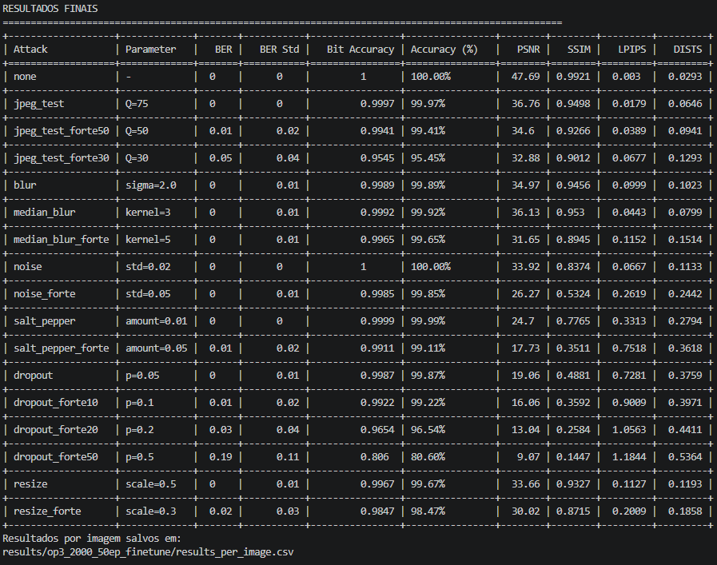

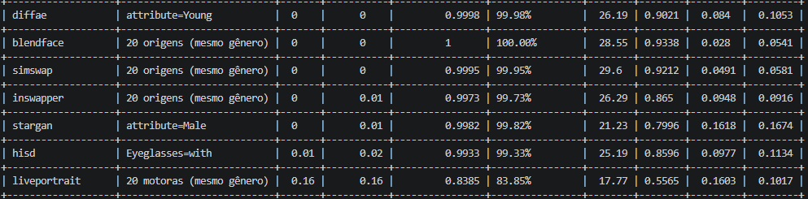

## Resultados da avaliação em 2000 imagens do LFW

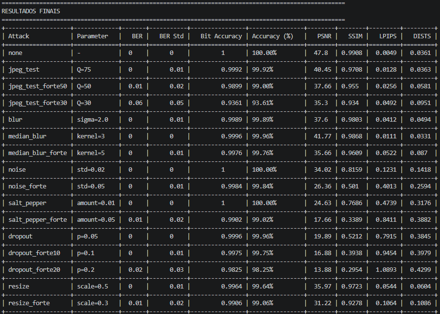


CSVs em `results/op3_2000_50ep_finetune/` (atual) e `results/op3_2000_50ep/` (etapa 1). O salt & pepper de 5% foi incluído depois; como ele entrou no meio da sequência de sorteios, os ataques aleatórios seguintes (ruído, salt & pepper, dropout) variam até ≈1 ponto em relação à avaliação anterior.

### Comparação entre as versões no mesmo PSNR (47,2 dB)

Cada modelo marcado com o alpha que dá PSNR médio de 47,2 dB (`output_subbandas/avaliar_ablacao.py`, 500 imagens: 250 femininas + 250 masculinas). % de imagens com a marca exata. "Grade" = pico ÷ média da energia da marca dentro da célula de 16×16 px (1 = espalhada por igual).

| Modelo | LPIPS | DISTS | Grade | JPEG50 | JPEG30 | Median 5 | Dropout 0,1 | Dropout 0,2 | Resize 0,3 |
|---|---|---|---|---|---|---|---|---|---|
| Versão 2 (fine-tuning) | 0,0086 | 0,0378 | – | 72,8 | 5,2 | 42,4 | 94,2 | 76,6 | 37,4 |
| Sem máscara, sem geométrico (do zero) | 0,0082 | 0,0381 | 11,1 | 76,0 | 6,2 | 61,8 | 97,4 | 78,6 | 29,2 |
| Máscara, sem geométrico | 0,0043 | 0,0333 | 10,0 | 88,0 | 22,8 | 87,0 | 64,0 | 26,2 | 64,8 |
| Máscara + geométrico (alpha 4, 30 épocas) | 0,0038 | 0,0335 | 7,4 | 87,4 | 26,6 | 92,2 | 60,0 | 25,6 | 68,6 |
| Máscara + geométrico (alpha 5, 50 épocas) — etapa 1 | 0,0039 | 0,0334 | 7,1 | 89,2 | 33,4 | 93,2 | 85,2 | 47,0 | 70,6 |
| **Versão 3 atual (etapa 1 + fine-tuning cosseno)** | 0,0040 | 0,0337 | **7,1** | **93,2** | **37,2** | **93,8** | **88,6** | **55,6** | **73,6** |

Leitura:

- **Máscara:** derruba o LPIPS pela metade e aumenta muito a robustez a JPEG, median e resize, mas piora o dropout.
- **Geométrico:** reduz a grade (10,0 → 7,4) e soma robustez.
- **Alpha 5 + 50 épocas:** recupera o dropout (0,1: 60 → 85; 0,2: 26 → 47) sem perder qualidade.
- **Fine-tuning cosseno:** +3 pontos na média (JPEG50 +4, JPEG30 +4, dropout 0,2 +9, resize 0,3 +3), mesma qualidade.
- Tudo o que **espalha** a marca melhora JPEG/median/resize e a qualidade, mas prejudica o dropout: a resistência ao dropout depende de marca concentrada em pixels isolados, que é justamente o que forma a grade.

### Exemplo visual


*Imagem 003251: original, marcada pela versão 3 (46,7 dB nesta imagem) e a diferença amplificada 15× da versão 1 e da versão 3 (embaixo, recorte ampliado entre os olhos). A versão 1 forma "X" regulares a cada 16 px; na versão 3 a grade some e sobra uma textura fina e irregular. Imagens em `my_tests/v3_finetune_cosine/`.*

### Marca d'água de cada modelo (imagem 003251)

Original, imagem marcada e diferença entre elas amplificada **15×** (`watermark_diff.py`, a mesma amplificação para todos), uma coluna por modelo:

| **Versão 3 (atual)** | SepMark | AdvMark | DeepGuard | FaceSigns | LIDMark | InvisMark |
|---|---|---|---|---|---|---|
| 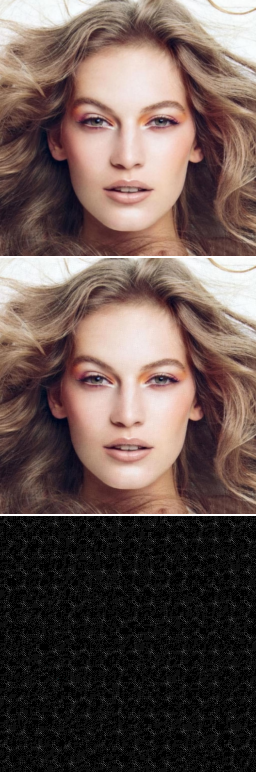 | 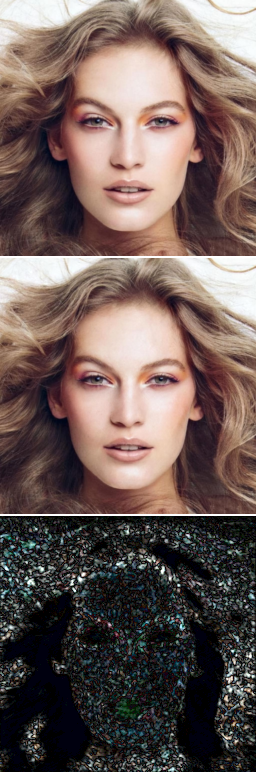 | 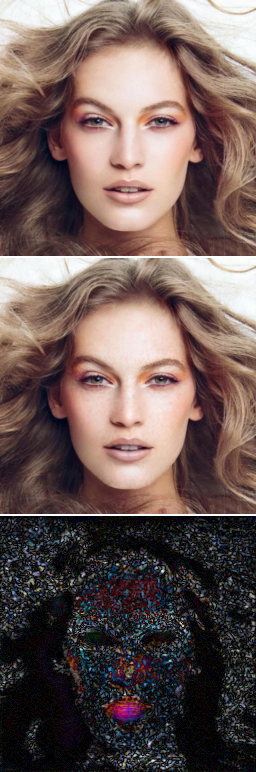 | 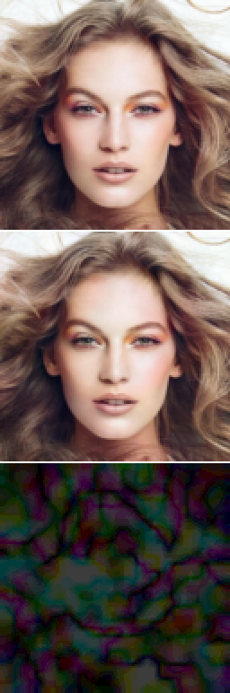 | 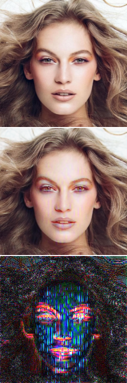 | 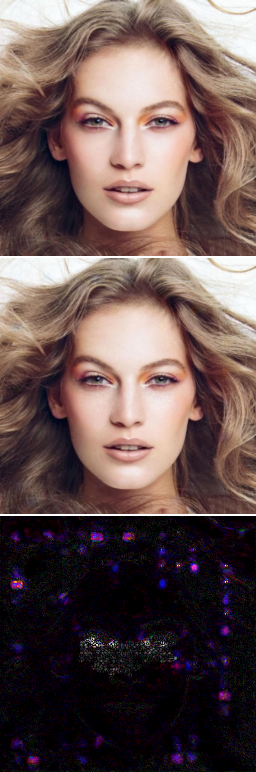 | 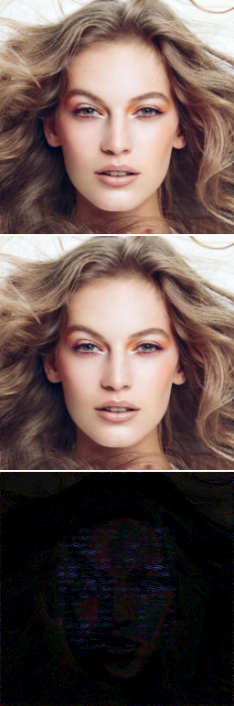 |

| Modelo | PSNR nesta imagem | Diferença média por pixel | Diferença máxima | Tamanho | Bits |
|---|---|---|---|---|---|
| **Versão 3 (atual)** | 46,74 dB | 0,80 | 7 | 256 | 30 |
| SepMark | 37,57 dB | 2,18 | 22 | 256 | 128 |
| AdvMark | 39,30 dB | 1,88 | 17 | 256 | 128 |
| DeepGuard | 40,55 dB | 2,04 | 4 | 128 | 30 |
| FaceSigns | 32,08 dB | 3,68 | 107 | 256 | 128 |
| LIDMark | 45,24 dB | 0,67 | 26 | 256 | 16 (+136 landmarks) |
| InvisMark | 50,08 dB | 0,43 | 9 | 256 | 100 |

- Diferença média e máxima em níveis de cinza (0–255), sem amplificação.
- **Versão 3:** textura fina, uniforme e sem cor (só na luminância), espalhada pela imagem toda, sem grade e sem regiões concentradas; a diferença máxima (7) é a menor entre os modelos que resistem ao JPEG.
- **SepMark e AdvMark:** textura colorida bem mais forte sobre o cabelo e o rosto (menos no fundo liso); no AdvMark aparecem também manchas coloridas nos lábios e nos olhos.
- **DeepGuard:** manchas suaves e coloridas de baixa frequência cobrindo a imagem toda (a marca é calculada numa imagem de 32×32 e ampliada): diferença máxima baixa (4), mas média alta (2,0).
- **FaceSigns:** listras verticais coloridas concentradas no rosto, as mais fortes de todas (até 107 níveis num pixel).
- **LIDMark:** quase nada na maior parte da imagem, com pontos fortes isolados (até 26 níveis) formando uma moldura e na região da boca.
- **InvisMark:** a mais fraca (diferença média 0,43), quase invisível mesmo amplificada, mas perde a marca em qualquer JPEG.
- Imagens marcadas pelos próprios scripts de avaliação de cada modelo (`--reference_name 003251.jpg`; para o InvisMark, `results_eval_v3ataques/watermarked_images/`), cada um com a sua mensagem. O DeepGuard trabalha em 128×128: as imagens dele foram ampliadas 2× (vizinho mais próximo, sem suavizar) para ficar do mesmo tamanho das outras; as métricas foram calculadas em 128×128 e as imagens originais estão em `my_tests/marca_por_modelo/DeepGuard/resultado_diff/128px/`. Arquivos em `my_tests/marca_por_modelo/<modelo>/resultado_diff/` (`original.png`, `marcada.png`, `diferenca.png`, `grid_comparativo.png`).

### Complexidade dos modelos

Medida do mesmo jeito para todos (`../../comparacao_modelos/medir_complexidade.py`): **parâmetros treináveis** (marcação e extração separados), **tamanho dos pesos** em float32 (parâmetros × 4 bytes; sem o estado do otimizador, que faz o arquivo do checkpoint ficar ≈3× maior) e **FLOPs por imagem** no tamanho de entrada de cada modelo (`torch.utils.flop_counter`; MACs = FLOPs ÷ 2).

| Modelo | Imagem | Bits | Marcação (M parâm.) | Extração (M parâm.) | Total (M parâm.) | Pesos (MB) | Marcação (GFLOPs) | Extração (GFLOPs) | Total (GFLOPs) |
|---|---|---|---|---|---|---|---|---|---|
| **Versão 3 (atual)** | 256 | 30 | 0,216 | 0,788 | **1,00** | 3,8 | 6,72 | 3,52 | 10,24 |
| SepMark | 256 | 128 | 10,957 | 4,419 (+ Detector igual) | **19,79** | 75,5 | 15,29 | 8,25 | 31,79 |
| AdvMark | 256 | 128 | 10,957 | 4,419 (+ Detector igual) | **19,79** | 75,5 | 15,29 | 8,25 | 31,79 |
| DeepGuard | 128 | 30 | 1,640 | 9,822 | **11,46** | 43,7 | 3,25 | 4,70 | 7,95 |
| FaceSigns | 256 | 128 | 10,983 | 7,888 | **18,87** | 72,0 | 5,70 | 5,00 | 10,70 |
| LIDMark | 256 | 16 (+136 landmarks) | 0,600 | 20,422 | **21,02** | 80,2 | 63,78 | 53,75 | 117,53 |
| InvisMark | 256 | 100 | 3,923 | 87,669 | **91,59** | 349,4 | 18,11 | 40,11 | 58,22 |

- A **versão 3 é o modelo mais leve**: 1,0 M de parâmetros, 11× menos que o DeepGuard e ≈20× menos que SepMark, AdvMark e FaceSigns. Em custo (FLOPs) fica no nível do DeepGuard e do FaceSigns e ≈3× abaixo do SepMark/AdvMark.
- SepMark e AdvMark têm dois extratores de mesmo tamanho (Tracer e Detector); o total soma os dois. O DeepGuard trabalha em 128×128, então os FLOPs dele não são diretamente comparáveis com os de 256×256.
- O contador do PyTorch não inclui FFT: a DCT da versão 3 (feita com FFT) fica de fora, mas o custo dela é pequeno perto das convoluções.
- Arquivos de cada medição em `../../comparacao_modelos/complexidade/<modelo>.json`.

### Código corretor de erros (BCH)

`bch_codec.py` divide os 30 bits escondidos em **15 bits de mensagem + 15 de paridade** (BCH(31, 16) encurtado para (30, 15)) e corrige até **3 bits errados** em qualquer posição, sem mudar a rede. Com mais de 3 erros, ele avisa que não conseguiu ler em ≈86% dos casos e devolve uma mensagem errada (erro silencioso) nos ≈14% restantes.

Comparação entre o **modelo atual** (4) e o **modelo 2** (máscara + geométrico, alpha 4, 30 épocas), cada um marcado com o **alpha em que foi treinado**, 2.000 imagens (cada imagem com uma mensagem de 15 bits diferente):

| | Alpha | PSNR | LPIPS |
|---|---|---|---|
| Modelo 2 | 4 | 49,5 dB | 0,0017 |
| **Modelo atual** | 5 | 47,7 dB | 0,0030 |

O modelo 2 nesse alpha tem uma marca mais fraca (mais qualidade), o que pesa contra ele na robustez.

| Ataque | Modelo 2: exata sem BCH | Modelo 2: certa com BCH | **Atual: exata sem BCH** | **Atual: certa com BCH** | Atual: falha avisada | Atual: erro silencioso |
|---|---|---|---|---|---|---|
| JPEG Q75 | 92,6% | 100% | 99,1% | **100%** | 0% | 0% |
| JPEG Q50 | 54,8% | 99,1% | 85,2% | **99,95%** | 0,05% | 0% |
| JPEG Q30 | 6,4% | 70,0% | 27,2% | **94,3%** | 4,8% | 0,9% |
| Blur σ=2 | 90,1% | 99,8% | 97,4% | **100%** | 0% | 0% |
| Median 3×3 | 93,1% | 100% | 97,7% | **100%** | 0% | 0% |
| Median 5×5 | 81,3% | 99,7% | 92,7% | **99,95%** | 0,05% | 0% |
| Ruído σ=0,02 | 99,4% | 100% | 100% | **100%** | 0% | 0% |
| Ruído σ=0,05 | 79,9% | 99,95% | 95,5% | **99,95%** | 0% | 0,05% |
| Salt & pepper 0,01 | 93,6% | 100% | 99,7% | **100%** | 0% | 0% |
| Salt & pepper 0,05 | – | – | 76,3% | **99,95%** | 0,05% | 0% |
| Dropout 0,05 | 67,4% | 99,1% | 95,2% | **100%** | 0% | 0% |
| Dropout 0,1 | 37,6% | 89,0% | 81,3% | **99,9%** | 0,1% | 0% |
| Dropout 0,2 | 12,5% | 54,6% | 44,4% | **95,1%** | 4,2% | 0,75% |
| Dropout 0,5 | 2,0% | 11,1% | 3,8% | 24,3% | 65,5% | 10,2% |
| Resize 0,5 | 81,1% | 99,4% | 91,9% | **99,85%** | 0,15% | 0% |
| Resize 0,3 | 52,1% | 95,6% | 71,4% | **99,1%** | 0,8% | 0,1% |

- **Com BCH, o modelo atual recupera a mensagem em ≥ 99% das imagens em 13 dos 16 ataques.** Ficam abaixo o JPEG Q30 (94,3%), o dropout 0,2 (95,1%, contra 44% sem BCH) e o dropout 0,5 (24,3%).
- **Ganho sobre o modelo 2:** JPEG Q30 70 → 94%, dropout 0,2 55 → 95%, dropout 0,1 89 → 99,9%, resize 0,3 96 → 99%.
- **Erros silenciosos** (o BCH devolve uma mensagem errada sem avisar) ficam em ≤ 0,9%, exceto no dropout 0,5 (10%).

CSVs em `results/bch_v3_2000_alpha5.csv` (atual) e `results/bch_op3geo_2000_alpha4.csv` (modelo 2), com o resultado por imagem em `*_por_imagem.csv`. Uma medição anterior do modelo 2 com alpha 5,312 (mesmo PSNR do atual) está em `results/bch_2000.csv`.

O custo é a capacidade: 15 bits = 32.768 mensagens diferentes (contra ≈1 bilhão com 30 bits). Para manter 30 bits de mensagem com a mesma proteção, a rede precisaria esconder ≈48 bits (retreino).

### Limitações conhecidas

> **Dropout de 50% retirado da avaliação (12/10/2026):** ele zera metade dos pixels e deixa a imagem sem uso (PSNR ≈9 dB), então não representa um ataque realista. Os números com ele nas tabelas acima ficam só como registro; o `evaluate.py`, o `avaliar_bch.py` e o `gerar_imagens_ataques.py` não o aplicam mais.

- **Dropout forte:** dropout 0,2 recupera a marca exata em 43% das imagens (95% com BCH) e dropout 0,5 em ≈4% (24% com BCH).
- **JPEG Q30 sem ECC:** 26% de marca exata, apesar de 95% dos bits certos; com BCH sobe para ≈94%.
- **Textura residual:** a grade some, mas a diferença amplificada ainda mostra uma textura fina, com leve orientação diagonal.
- **Força maior:** precisa de alpha 5,3 para o mesmo PSNR das versões 1 e 2 (alpha 4), porque a máscara elimina parte dos coeficientes.
- **Duas mudanças ao mesmo tempo:** alpha 5 e 50 épocas vieram juntos, então não dá para atribuir o ganho no dropout a uma delas.
- **Deepfakes ainda não avaliados** nesta versão.

## Os 4 modelos deste projeto

Todos em `output_grade/<pasta>/checkpoints/` (o `*_final.pth` é o modelo; o `*_model.pth` é a cópia de segurança salva a cada 5.000 passos e é redundante). Todos usam a máscara DCT mid-band, 30 bits, pesos 0,30 / 0,35 / 0,35 / 0,001, LPIPS 0,005, batch 32 e seed 42.

| # | Pasta | Checkpoint | Ataques | Alpha final | Treino | Média difíceis* | LPIPS* | Papel |
|---|---|---|---|---|---|---|---|---|
| 1 | `op3_dct_midband` | `…11102026_11:44:46_final.pth` | v3 (sem geométrico) | 4 | do zero, 30 épocas | 54,8 | 0,0043 | efeito da máscara sozinha |
| 2 | `op3_v2_geometrico` | `…11102026_16:09:29_final.pth` | v2 (com geométrico) | 4 | do zero, 30 épocas | 56,3 | 0,0038 | efeito de somar o geométrico |
| 3 | `op3_v2_geometrico_alpha5_50ep` | `…11102026_20:41:44_final.pth` | v2 | 5 | do zero, 50 épocas | 61,5 | 0,0039 | etapa 1 da versão 3 |
| 4 | `v3_finetune_cosine` | `…12102026_08:55:13_final.pth` | v2 | 5 | modelo 3 + 15 épocas, LR em cosseno | **64,5** | 0,0040 | **modelo atual** (etapa 2) |

\* No mesmo PSNR (47,2 dB), 500 imagens; média da marca exata nos 7 ataques difíceis (JPEG50, JPEG30, median 5×5, dropout 0,2 e 0,5, resize 0,5 e 0,3). Resultados completos na tabela [Comparação entre as versões no mesmo PSNR](#comparação-entre-as-versões-no-mesmo-psnr-472-db).

### 1. `op3_dct_midband` — máscara, sem geométrico

Primeiro modelo com a máscara (variante 3 do `../experimento_grade/`), com os mesmos ataques e receita da referência sem máscara, para isolar o efeito dela. Em relação à referência: a grade de pontos some (fica uma textura diagonal), LPIPS 0,0082 → 0,0043, média 49,5 → 54,8 (JPEG30 6 → 23, median 5×5 62 → 87, resize 0,3 29 → 65), mas o dropout cai (dropout 0,2: 79 → 26). Precisa de alpha 5,365 para o mesmo PSNR.

```bash
python train.py --dataset_path Dataset/celeba_hq/train --image_resolution 256 --watermark_size 30 \
    --output output_grade/op3_dct_midband --batch_size 32 --num_epochs 30 --lr 5e-5 --seed 42 \
    --min_alpha 4 --alpha_patience 1000 --attack_set v3 --lpips_weight 0.005 \
    --subband_weights 0.30,0.35,0.35,0.001
```

Avaliação no mesmo PSNR: `../experimento_grade/op3_dct_midband.csv`. Imagem 003251: `my_tests/alpha_5.365/` e `my_tests/alpha_4/`.

### 2. `op3_v2_geometrico` — máscara + geométrico

Igual ao 1, com o ataque geométrico (`--attack_set v2`). Os dois efeitos se somam: grade 10,0 → 7,4, LPIPS 0,0043 → 0,0038, média 54,8 → 56,3 (median 5×5 92, resize 0,3 69) e a textura diagonal fica bem mais fraca. O dropout continua baixo (dropout 0,2: 26%). Precisa de alpha 5,312 para o mesmo PSNR.

```bash
python train.py --dataset_path Dataset/celeba_hq/train --image_resolution 256 --watermark_size 30 \
    --output output_grade/op3_v2_geometrico --batch_size 32 --num_epochs 30 --lr 5e-5 --seed 42 \
    --min_alpha 4 --alpha_patience 1000 --attack_set v2 --lpips_weight 0.005 \
    --subband_weights 0.30,0.35,0.35,0.001
```

Avaliações: mesmo PSNR em `../experimento_grade/op3_v2_geometrico.csv`; 2.000 imagens com alpha 5,312 em `results/op3_2000_mesmo_psnr/` (PSNR 47,13, LPIPS 0,0038; marca exata: JPEG50 82,3%, JPEG30 21,7%, median 5×5 91,9%, dropout 0,1 56,9%, dropout 0,2 22,3%, resize 0,3 71,3%). BCH deste modelo: `results/bch_op3geo_2000_alpha4.csv` (alpha 4) e `results/bch_2000.csv` (alpha 5,312). Imagem 003251: `my_tests/op3_v2_geometrico_alpha_5.312/`.

### 3. `op3_v2_geometrico_alpha5_50ep` — etapa 1 da versão 3

Igual ao 2, com alpha final 5 e 50 épocas. O ganho principal é no dropout (dropout 0,1: 60 → 85; dropout 0,2: 26 → 47) e na média (56,3 → 61,5), com a mesma qualidade. As duas mudanças vieram juntas, então não dá para atribuir o ganho a uma delas. É o ponto de partida do modelo 4. Comando em [Treino](#treino) (etapa 1).

Avaliações: 2.000 imagens com alpha 5 em `results/op3_2000_50ep/`; mesmo PSNR em `output_grade/comparacao_alpha5_50ep.csv` e `output_grade/comparacao_v3_finetune.csv`. Imagem 003251: `my_tests/v3_alpha5_50ep/`.

### 4. `v3_finetune_cosine` — modelo atual

O modelo 3 continuado por 15 épocas com o LR descendo em cosseno de 2e-5 até 1e-6 (alpha fixo em 5). Mesma qualidade e +3 pontos na média no mesmo PSNR (JPEG50 89 → 93, dropout 0,2 47 → 56, resize 0,3 71 → 74). Comando em [Treino](#treino) (etapa 2); resultados completos em [Resultados](#resultados).

Avaliações: 2.000 imagens com alpha 5 em `results/op3_2000_50ep_finetune/`; mesmo PSNR em `output_grade/comparacao_v3_finetune.csv`. Imagem 003251: `my_tests/v3_finetune_cosine/`.

## Comandos

Ambiente `watermark-v8` (com `bchlib` para o BCH).

### Treino

Etapa 1 — do zero:

```bash
python train.py \
    --dataset_path Dataset/celeba_hq/train \
    --image_resolution 256 \
    --watermark_size 30 \
    --output output_grade/op3_v2_geometrico_alpha5_50ep \
    --batch_size 32 \
    --num_epochs 50 \
    --lr 5e-5 \
    --seed 42 \
    --min_alpha 5 \
    --alpha_patience 1000 \
    --attack_set v2 \
    --lpips_weight 0.005 \
    --subband_weights 0.30,0.35,0.35,0.001
```

Etapa 2 — fine-tuning com LR em cosseno (modelo atual):

```bash
python train.py \
    --dataset_path Dataset/celeba_hq/train \
    --image_resolution 256 \
    --watermark_size 30 \
    --output output_grade/v3_finetune_cosine \
    --resume "output_grade/op3_v2_geometrico_alpha5_50ep/checkpoints/watermark_Y_DCT_DWT_11102026_20:41:44_final.pth" \
    --min_alpha 5 \
    --attack_set v2 \
    --lpips_weight 0.005 \
    --batch_size 32 \
    --num_epochs 15 \
    --lr 2e-5 \
    --lr_schedule cosine \
    --lr_min 1e-6 \
    --seed 42
```

- A máscara DCT já está no código deste projeto (`watermark_embedding.py`); não há opção para ligá-la.
- **Use um `--output` diferente para cada treino:** a avaliação no mesmo PSNR (`avaliar_ablacao.py`) identifica o modelo pelo nome da pasta e, com dois checkpoints na mesma pasta, avalia só o último.

### Validação

```bash
python evaluate.py \
    --models_path "output_grade/v3_finetune_cosine/checkpoints/watermark_Y_DCT_DWT_12102026_08:55:13_final.pth" \
    --image_resolution 256 \
    --celeba_val_dir Dataset/celeba_hq/val \
    --output results/op3_2000_50ep_finetune \
    --deepfake false
```

- `--alpha` (opcional) troca a força usada para marcar; sem ele, usa o alpha do checkpoint (5). `--alpha 5.337` dá o mesmo PSNR (47,2 dB) das versões 1 e 2.
- Com deepfakes: `--deepfake true --limit 100` e outro `--output`.

### Comparação no mesmo PSNR

```bash
python output_subbandas/avaliar_ablacao.py --dir output_grade \
    --models op3_v2_geometrico_alpha5_50ep,v3_finetune_cosine \
    --no_v2_base --num_images 500 --output output_grade/comparacao.csv
```

### BCH

```bash
python avaliar_bch.py \
    --models_path "output_grade/v3_finetune_cosine/checkpoints/watermark_Y_DCT_DWT_12102026_08:55:13_final.pth" \
    --alpha 5 \
    --output results/bch_v3_2000_alpha5.csv
```

### Imagem de referência

```bash
python collect_image_by_diff.py \
    --models_path "output_grade/v3_finetune_cosine/checkpoints/watermark_Y_DCT_DWT_12102026_08:55:13_final.pth" \
    --dataset_dir Dataset/celeba_hq/val --output_dir my_tests/v3_finetune_cosine \
    --reference_name 003251 --reference_file 003251.jpg --image_resolution 256

python watermark_diff.py \
    --original my_tests/v3_finetune_cosine/003251_original.png \
    --watermarked my_tests/v3_finetune_cosine/003251_marcada.png \
    --output_dir my_tests/v3_finetune_cosine/resultado_diff
```

`collect_image_by_diff.py` também aceita `--alpha`.

## Arquivos

| Caminho | Conteúdo |
|---|---|
| `output_grade/v3_finetune_cosine/` | **checkpoint e logs do modelo atual** (etapa 2, fine-tuning) |
| `output_grade/op3_v2_geometrico_alpha5_50ep/` | etapa 1 (do zero, 50 épocas) |
| `output_grade/comparacao_v3_finetune.csv` | comparação no mesmo PSNR: etapa 1 e fine-tuning |
| `output_grade/op3_dct_midband/`, `output_grade/op3_v2_geometrico/` | variantes intermediárias (máscara sem geométrico; máscara + geométrico com alpha 4 e 30 épocas) |
| `results/op3_2000_50ep_finetune/` | avaliação do modelo atual nas 2.000 imagens |
| `results/op3_2000_50ep/` | avaliação da etapa 1 (modelo 3) |
| `results/op3_2000_mesmo_psnr/` | avaliação do modelo 2 (máscara + geométrico, alpha 4) com alpha 5,312 |
| `results/bch_v3_2000_alpha5.csv` | BCH no modelo atual (alpha 5) |
| `results/bch_op3geo_2000_alpha4.csv`, `results/bch_2000.csv` | BCH no modelo 2 (alpha 4 e alpha 5,312) |
| `bch_codec.py`, `avaliar_bch.py` | código corretor de erros e sua avaliação |
| `../experimento_grade/` | experimento das 4 variantes contra a grade, comparações e figuras |
| `Dataset/` | link para o dataset do projeto original |
